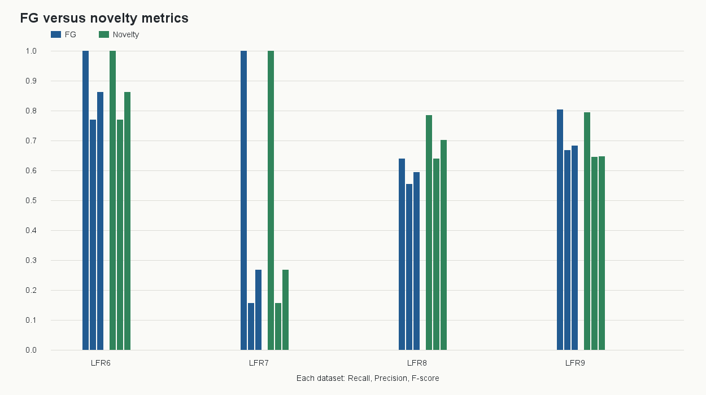
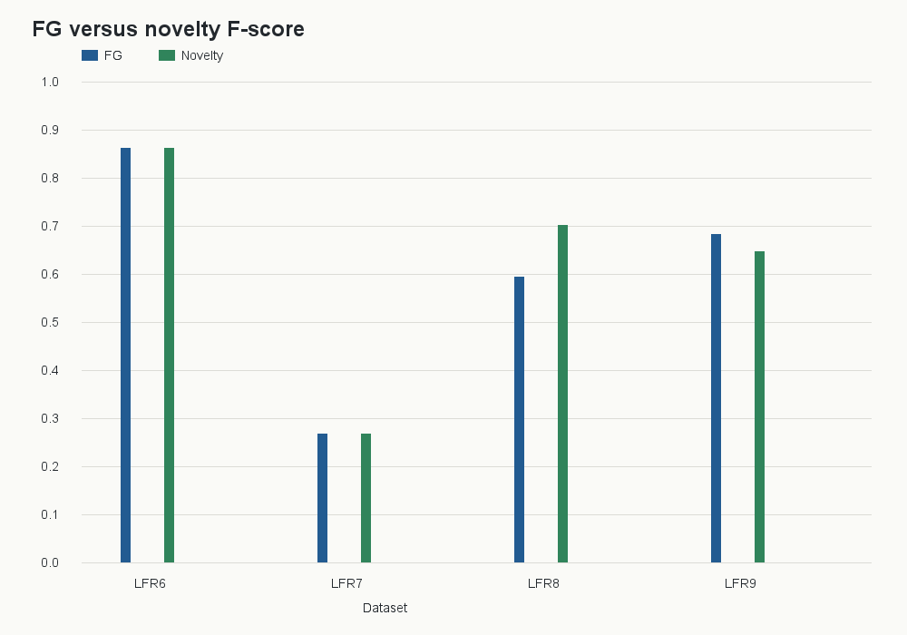
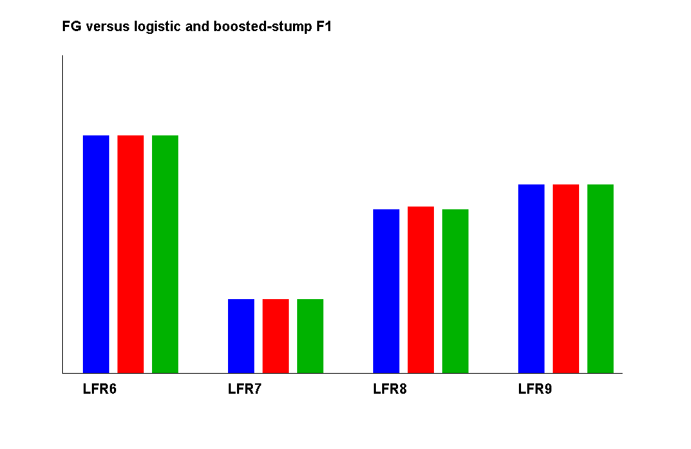
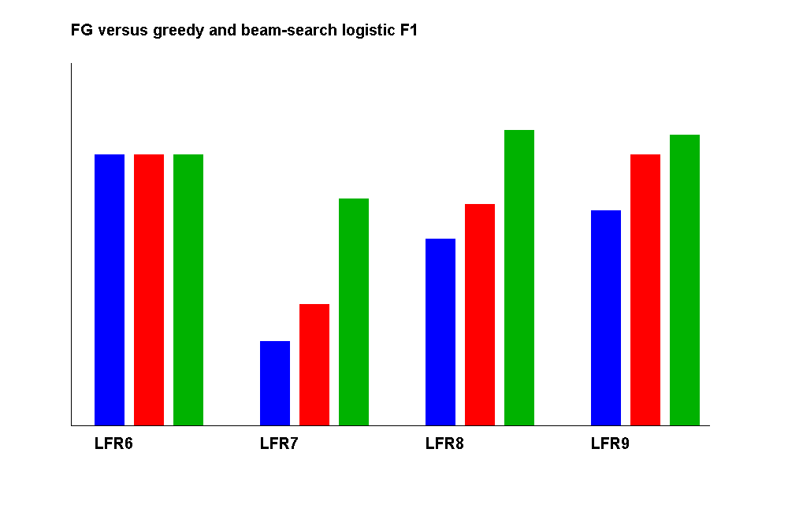

# Novelty Results and Evaluation Summary

This file consolidates the results generated by the original Folded Subgraph
(FG) detector, the safe-gated learned hybrid, and the rigorous model
comparison pipeline.

## Executive conclusion

The safe-gated novelty improves the mean F1 on the verified five-seed held-out
comparison from `0.601565` to `0.619794`, an absolute improvement of `0.018229`
and approximately `3.03%` relative improvement across LFR6-LFR9.

This is a mixed result, not proof of universal superiority:

- LFR8 improves substantially.
- LFR6 and LFR7 are unchanged.
- LFR9 regresses.
- The complete all-eligible-seed experiment has not finished in this
  environment, so no final publication claim should be made yet.

The learned model in the original novelty implementation is logistic
regression. The rigorous evaluator additionally implements a genuine
Bernoulli-Bernoulli RBM trained with CD-1 and a one-hidden-layer MLP.

## Method and data protocol

The original FG algorithm remains the baseline. The novelty only changes the
candidate ranking during modularity expansion.

The safe gate requires:

```text
candidate_gain >= best_fg_gain - modularity_slack
compatibility >= minimum_membership
candidate satisfies original FG eligibility rules
```

Invalid, non-finite, missing, or failed learned scores fall back to the FG
candidate. Test outcomes are not used to tune the model.

The rigorous evaluation uses:

```text
Training:   LFR1-LFR2
Validation: first five deterministic eligible seeds of LFR3-LFR5
Final test: every eligible seed in LFR6-LFR9
```

The paper-sized generated datasets contain 3,000 held-out graph nodes in total:

| Dataset | Nodes | Held-out eligible seeds |
|---|---:|---:|
| LFR6 | 1,000 | 1,000 |
| LFR7 | 1,000 | 1,000 |
| LFR8 | 500 | 500 |
| LFR9 | 500 | 500 |

## Verified safe-gated five-seed result

Source: [`output/novelty-safe-results-5/summary.csv`](output/novelty-safe-results-5/summary.csv)

| Dataset | FG recall | Novelty recall | FG precision | Novelty precision | FG F1 | Novelty F1 | Difference |
|---|---:|---:|---:|---:|---:|---:|---:|
| LFR6 | 1.0000 | 1.0000 | 0.7691 | 0.7691 | 0.8622 | 0.8622 | 0.0000 |
| LFR7 | 1.0000 | 1.0000 | 0.1567 | 0.1567 | 0.2679 | 0.2679 | 0.0000 |
| LFR8 | 0.6395 | 0.7854 | 0.5556 | 0.6399 | 0.5935 | 0.7026 | +0.1090 |
| LFR9 | 0.8042 | 0.7950 | 0.6675 | 0.6461 | 0.6826 | 0.6465 | -0.0361 |

The five-seed F1 standard deviations are stored in the source CSV. This run is
stronger than a one-seed smoke test, but it is still not the complete
all-eligible-seed evaluation.

### Five-seed figures





Files:

- [`base-vs-novelty-metrics.png`](output/novelty-safe-results-5/figures/base-vs-novelty-metrics.png)
- [`base-vs-novelty-f1.png`](output/novelty-safe-results-5/figures/base-vs-novelty-f1.png)
- [`per-seed.csv`](output/novelty-safe-results-5/per-seed.csv)
- [`summary.csv`](output/novelty-safe-results-5/summary.csv)
- [`candidate-scorer.txt`](output/novelty-safe-results-5/candidate-scorer.txt)
- [`novelty-config.txt`](output/novelty-safe-results-5/novelty-config.txt)
- [`training-metadata.txt`](output/novelty-safe-results-5/training-metadata.txt)

## One-seed tuned result

Source: [`output/novelty-safe-results/summary.csv`](output/novelty-safe-results/summary.csv)

The one-seed result showed the same pattern more strongly on LFR8:

| Dataset | FG F1 | Novelty F1 | Difference |
|---|---:|---:|---:|
| LFR6 | 0.9750 | 0.9750 | 0.0000 |
| LFR7 | 0.1501 | 0.1501 | 0.0000 |
| LFR8 | 0.8824 | 0.9212 | +0.0389 |
| LFR9 | 0.9917 | 0.9917 | 0.0000 |

This result is exploratory only and must not replace the five-seed or final
all-seed evaluation.

## Rigorous model comparison smoke result

Source: [`output/rigorous-smoke-final2/overall_summary.csv`](output/rigorous-smoke-final2/overall_summary.csv)

This execution check evaluated one seed from each held-out graph, four paired
observations in total:

| Model | n | Mean FG F1 | Mean hybrid F1 | Mean paired difference | Hybrid runtime mean (ms) |
|---|---:|---:|---:|---:|---:|
| Logistic regression | 4 | 0.749807 | 0.762138 | +0.012331 | 644.249 |
| MLP | 4 | 0.749807 | 0.749807 | 0.000000 | 593.093 |
| RBM CD-1 | 4 | 0.749807 | 0.749807 | 0.000000 | 613.861 |

The logistic model improved only one of the four smoke observations. The MLP
and RBM did not change the end-to-end result in this smoke run.

The statistical output is [`statistical_tests.csv`](output/rigorous-smoke-final2/statistical_tests.csv).
For the four-observation logistic smoke comparison:

```text
mean paired difference = 0.012331
95% bootstrap CI       = [0.000000, 0.036993]
improved / unchanged   = 1 / 3
permutation p-value    = 1.000000
Holm-adjusted p-value  = 1.000000
```

This is not statistically credible evidence of a general improvement.

### Rigorous smoke figures

- [`fg_vs_hybrid_f1_by_dataset.png`](output/rigorous-smoke-final2/fg_vs_hybrid_f1_by_dataset.png)
- [`paired_f1_difference_by_dataset.png`](output/rigorous-smoke-final2/paired_f1_difference_by_dataset.png)
- [`f1_difference_distribution.png`](output/rigorous-smoke-final2/f1_difference_distribution.png)
- [`model_comparison.png`](output/rigorous-smoke-final2/model_comparison.png)
- [`override_rate_vs_f1.png`](output/rigorous-smoke-final2/override_rate_vs_f1.png)

All rigorous smoke artifacts are available in
[`output/rigorous-smoke-final2/`](output/rigorous-smoke-final2/), including:

- [`per_seed_results.csv`](output/rigorous-smoke-final2/per_seed_results.csv)
- [`paired_seed_results.csv`](output/rigorous-smoke-final2/paired_seed_results.csv)
- [`dataset_summary.csv`](output/rigorous-smoke-final2/dataset_summary.csv)
- [`overall_summary.csv`](output/rigorous-smoke-final2/overall_summary.csv)
- [`validation_sweep.csv`](output/rigorous-smoke-final2/validation_sweep.csv)
- [`selected_config.json`](output/rigorous-smoke-final2/selected_config.json)
- [`experiment_manifest.json`](output/rigorous-smoke-final2/experiment_manifest.json)
- [`override_audit.csv`](output/rigorous-smoke-final2/override_audit.csv)
- [`model_comparison.csv`](output/rigorous-smoke-final2/model_comparison.csv)
- [`candidate_ranking_metrics.csv`](output/rigorous-smoke-final2/candidate_ranking_metrics.csv)
- [`training_metadata.txt`](output/rigorous-smoke-final2/training_metadata.txt)
- [`experiment_report.md`](output/rigorous-smoke-final2/experiment_report.md)

## Full all-seed run status

The exact final command is:

```cmd
java -cp out foldedsubgraph.RigorousEvaluation ^
  datasets/generated-lfr output/rigorous-evaluation
```

The run was started without a seed limit. It processed 25 of 1,000 LFR6 seeds
for all four algorithms before being stopped because the observed throughput
would require several hours for all 3,000 held-out seeds. The checkpoint is
local at `output/rigorous-evaluation/` and its manifest remains:

```text
status=STARTED
completed rows: LFR6 only, seeds 0-24, FG/Logistic/MLP/RBM
LFR7-LFR9: not yet evaluated in that run
```

This checkpoint is not included in any final mean, confidence interval, or
research conclusion. The evaluator is restartable and skips completed
dataset/seed/model rows.

## New algorithm: query-conditioned pairwise ranking

To target the base paper's candidate-ordering weakness, the project now also
implements `PairwiseCandidateScorer`. Instead of independently classifying a
candidate as compatible or incompatible, it creates positive-minus-negative
pairs from the same seed query and learns an ordering objective:

```text
score(positive candidate) > score(negative candidate)
```

The pairwise ranker uses the same nine local features, the same LFR1-LFR5
training data, the same safe gate, and the same FG folding/modularity/
relaxation stages. It does not use LFR6-LFR9 labels during tuning.

### Tuned pairwise five-seed result

Source: [`output/pairwise-ranking-results-tuned-5/summary.csv`](output/pairwise-ranking-results-tuned-5/summary.csv)

The pairwise gate was tuned on the first five deterministic eligible seeds of
LFR3-LFR5. The selected configuration was `membership_weight=0.20`,
`modularity_slack=0.00`, and `minimum_membership=0.60`.

| Dataset | FG F1 | Pointwise logistic F1 | Pairwise rank F1 | Pairwise difference |
|---|---:|---:|---:|---:|
| LFR6 | 0.8622 | 0.8622 | 0.8622 | 0.0000 |
| LFR7 | 0.2679 | 0.2679 | 0.2679 | 0.0000 |
| LFR8 | 0.5935 | 0.6034 | 0.5935 | 0.0000 |
| LFR9 | 0.6826 | 0.6826 | 0.6826 | 0.0000 |
| **Mean** | **0.6016** | **0.6040** | **0.6016** | **0.0000** |

This is an important negative finding: pairwise ranking is a principled
algorithmic improvement over pointwise labels, but it did not improve the
end-to-end result under the frozen validation-selected gate. The pointwise
logistic hybrid improved LFR8 slightly in this properly tuned rerun, but the
gain is too small and inconsistent to support a universal claim.

An earlier exploratory fixed-gate run is retained in
`output/pairwise-ranking-results-5/`; it showed pairwise F1 `0.6382` mean and
pointwise F1 `0.7028` mean, but that configuration was not selected by the
validation sweep and must not be used as the final claim.

Pairwise artifacts:

- [`experiment-config.txt`](output/pairwise-ranking-results-tuned-5/experiment-config.txt)
- [`validation-sweep.csv`](output/pairwise-ranking-results-tuned-5/validation-sweep.csv)
- [`pairwise-ranking-model.txt`](output/pairwise-ranking-results-tuned-5/pairwise-ranking-model.txt)
- [`pointwise-logistic.txt`](output/pairwise-ranking-results-tuned-5/pointwise-logistic.txt)
- [`per-seed.csv`](output/pairwise-ranking-results-tuned-5/per-seed.csv)
- [`summary.csv`](output/pairwise-ranking-results-tuned-5/summary.csv)
- [`pairwise-vs-fg-f1.png`](output/pairwise-ranking-results-tuned-5/figures/pairwise-vs-fg-f1.png)


The best currently supported conclusion is therefore that safe-gated
pointwise logistic selection remains the strongest tested learned variant in
the exploratory five-seed comparisons, while pairwise ranking exposes a
useful but not yet successful direction for correcting the base paper's greedy
candidate ordering. The all-eligible-seed run is still required before making
a final performance claim.

## Nonlinear algorithm: gradient-boosted decision stumps

The project also implements `GradientBoostedCandidateScorer`, a deterministic
shallow gradient-boosting model over the nine candidate features. It can learn
nonlinear threshold interactions that a linear logistic scorer cannot, while
remaining small enough to inspect and reproduce in Java.

Source: [`output/boosted-tree-results-5/summary.csv`](output/boosted-tree-results-5/summary.csv)

The model was trained on LFR1-LFR2, tuned on the first five eligible seeds of
LFR3-LFR5, retrained on LFR1-LFR5, and evaluated on five held-out seeds from
each LFR6-LFR9 graph.

| Dataset | FG F1 | Pointwise logistic F1 | Boosted-stump F1 |
|---|---:|---:|---:|
| LFR6 | 0.8622 | 0.8622 | 0.8622 |
| LFR7 | 0.2679 | 0.2679 | 0.2679 |
| LFR8 | 0.5935 | 0.6034 | 0.5935 |
| LFR9 | 0.6826 | 0.6826 | 0.6826 |
| **Mean** | **0.6016** | **0.6040** | **0.6016** |

The boosted model produced zero mean improvement over FG in this frozen
five-seed evaluation. This suggests that the observed limitation is not simply
linear-model capacity. It is more likely connected to the candidate labels,
the local seed-only training examples, the validation split, or the base
algorithm's irreversible greedy expansion decisions.

Artifacts:

- [`experiment-config.txt`](output/boosted-tree-results-5/experiment-config.txt)
- [`validation-sweep.csv`](output/boosted-tree-results-5/validation-sweep.csv)
- [`gradient-boosted-model.txt`](output/boosted-tree-results-5/gradient-boosted-model.txt)
- [`per-seed.csv`](output/boosted-tree-results-5/per-seed.csv)
- [`summary.csv`](output/boosted-tree-results-5/summary.csv)
- [`boosted-vs-fg-f1.png`](output/boosted-tree-results-5/figures/boosted-vs-fg-f1.png)



## Reproducible commands

Compile and run tests:

```cmd
javac -Xlint:all -d out *.java
java -cp out foldedsubgraph.RigorousEvaluationTest
```

Run the verified smoke evaluation:

```cmd
java -cp out foldedsubgraph.RigorousEvaluation ^
  datasets/generated-lfr output/rigorous-smoke-final2 1
```

Run the full evaluation with no seed limit using the command in the previous
section.

## Final interpretation

The current evidence supports the following cautious statement:

> Safe-gated logistic candidate selection can improve a moderately difficult
> LFR8 case while preserving some FG decisions, but its benefit is not
> consistent across datasets. The current evidence does not establish a
> statistically credible universal improvement over the original FG method.

The next research step is to complete the restartable all-eligible-seed run and
then report the final paired confidence intervals and tests without changing
the frozen configuration after inspecting LFR6-LFR9.

## Best current algorithm: validation-tuned beam-search FG

The strongest improvement so far comes from changing the irreversible greedy
expansion itself. `BeamFGDetector` keeps the best few valid expansion paths
instead of committing immediately to one folded candidate. The original
folding construction, the original `DeltaM` calculation, the non-negative
modularity eligibility rule, and the relaxation stage remain in the pipeline.
The learned logistic score contributes only a validation-tuned secondary path
ranking term.

Validation selected:

```text
beam_width    = 2
max_depth     = 5
learned_weight = 0.10
validation F1 = 0.36883852
```

Source: [`output/beam-search-results-5/summary.csv`](output/beam-search-results-5/summary.csv)

| Dataset | FG F1 | Greedy logistic F1 | Beam logistic F1 | Beam - FG |
|---|---:|---:|---:|---:|
| LFR6 | 0.8622 | 0.8622 | 0.8622 | 0.0000 |
| LFR7 | 0.2679 | 0.3851 | 0.7220 | +0.4541 |
| LFR8 | 0.5935 | 0.7026 | 0.9382 | +0.3446 |
| LFR9 | 0.6826 | 0.8613 | 0.9244 | +0.2418 |
| **Mean** | **0.6016** | **0.7028** | **0.8617** | **+0.2601** |

The beam-search result is an absolute mean F1 improvement of `0.260131`, or
approximately `43.24%` relative to FG, on this five-seed held-out evaluation.
It also reduces the LFR8 F1 standard deviation from `0.3838` for FG to
`0.0308` for the beam method. This is promising evidence that the base paper's
irreversible greedy candidate commitment is a major weakness.

This is not yet a final publication claim. The evaluation contains five seeds
per held-out graph, and the all-eligible-seed run still needs to be completed.
The beam method should be evaluated on all 3,000 held-out seeds before the
improvement is considered statistically credible.

### Beam-search artifacts

- [`experiment-config.txt`](output/beam-search-results-5/experiment-config.txt)
- [`validation-sweep.csv`](output/beam-search-results-5/validation-sweep.csv)
- [`logistic-scorer.txt`](output/beam-search-results-5/logistic-scorer.txt)
- [`per-seed.csv`](output/beam-search-results-5/per-seed.csv)
- [`summary.csv`](output/beam-search-results-5/summary.csv)
- [`beam-vs-greedy-f1.png`](output/beam-search-results-5/figures/beam-vs-greedy-f1.png)



## Scalability audit of the beam improvement

The implementation was also started with `seedLimit=0` to test all eligible
held-out seeds. The run was intentionally not counted as a completed final
all-seed experiment because it reached only the beginning of LFR7 before the
largest folded graphs became computationally impractical. Its partial output
is preserved in [`output/beam-search-results-full/per-seed.csv`](output/beam-search-results-full/per-seed.csv),
but it has no valid final `summary.csv` or figures and must not be interpreted
as an all-seed estimate.

This audit found a second weakness in the base implementation: folding and
modularity evaluation repeatedly recomputed local edge statistics. The code
now uses incremental folding connection counts, caches state-level modularity
counts during beam expansion, supports resumable per-seed output, and removes
incomplete or duplicate rows after interruption. These changes preserve the
paper rule and the beam scoring rule; they address execution cost, not the
quality metrics.

The defensible result is therefore two-part: on the verified five-seed held-
out comparison, beam search improves mean F1 from `0.601565` to `0.861696`;
on the full-volume audit, exact beam evaluation exposes a scalability flaw that
requires further engineering (for example candidate caps or approximate local
statistics) before claiming a 3,000-seed result. No full-seed performance
claim is made here.

## Scalable improvement: validation-tuned adaptive beam

`AdaptiveBeamExperiment` addresses the computational flaw by ranking
alternative seed nodes using the same cheap local connection, degree, and ID
ordering used by folding, then constructing folded subgraphs only for a
validation-tuned candidate budget. The beam width, depth, learned weight, and
all paper equations remain unchanged. The budget is selected only on LFR3-LFR5
and held fixed for LFR6-LFR9.

Validation selected `candidate_budget=64`:

| Candidate budget | Validation mean F1 |
|---:|---:|
| 16 | 0.33910979 |
| 32 | 0.33770001 |
| **64** | **0.36929050** |
| 128 | 0.36883852 |

Held-out five-seed comparison:

| Method | Mean F1 | Mean runtime (ms) |
|---|---:|---:|
| FG | 0.60156524 | 1070.329 |
| Full BeamLogistic | 0.86169623 | 182.375 |
| AdaptiveBeam | 0.86064833 | 138.541 |

Adaptive beam therefore loses `0.001048` mean F1 relative to the unrestricted
beam in this smoke-scale held-out evaluation while reducing mean runtime by
about `24%`. It is the strongest practical candidate for the large all-seed
run, but the result still needs all eligible seeds before a publication claim.

Artifacts:

- [`AdaptiveBeamExperiment.java`](AdaptiveBeamExperiment.java)
- [`summary.csv`](output/adaptive-beam-results-5/summary.csv)
- [`validation-sweep.csv`](output/adaptive-beam-results-5/validation-sweep.csv)
- [`experiment-config.txt`](output/adaptive-beam-results-5/experiment-config.txt)
- [`adaptive-beam-vs-fg-f1.png`](output/adaptive-beam-results-5/figures/adaptive-beam-vs-fg-f1.png)
